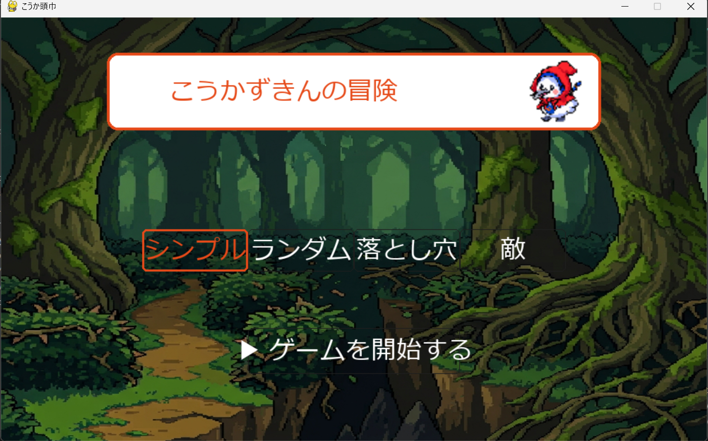
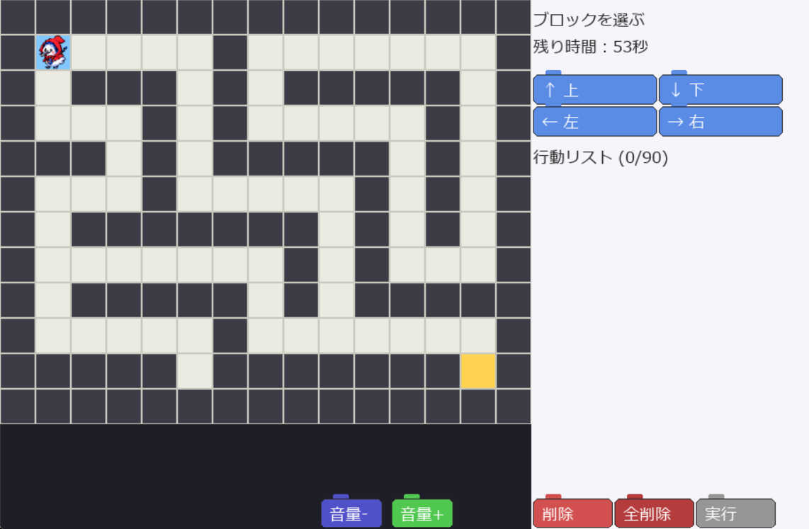

#  こうか頭巾の冒険 

---
## 実行環境の必要条件
* python >= 3.10
* pygame >= 2.1

## ゲームの概要
こうか頭巾の行動をスクラッチのようにブロックで作ってもらい迷路を攻略するゲーム

## ゲームの遊び方
* 最初にマップを選択しスタートボタンを押す
* 制限時間内に行動ブロックをクリックかキーボードの矢印キーで組み立て実行ボタンを押すことでこうか頭巾を移動させ迷路をクリアするゲーム
### ギミック
* 落とし穴 : ハマってみるまでどこにあるかわからない。
* 敵 : 追ってきたり,一定区間を行き来している。
* 扉と鍵 : 鍵を拾ってから出ないと通れない

## ゲームの実装
### 共通基本機能
* 基本行動(上下左右)
* マップ
* ゴールと時間切れ時の簡易メッセージの表示

### 分担追加機能
* 制限時間（担当：恩田）：設定した制限時間（60秒）に達すると、ゲームが終了する機能
* 全削除（担当：恩田）：全削除ボタンを押すと、追加した指示をすべて削除する機能
* 落とし穴を追加(担当:滝嶋) : 落とし穴に落ちるとゲームオーバーになり再挑戦じにハマった落とし穴の位置が色付けされる。
* BGM再生機能と音量ボタン（担当：日吉）`/music`フォルダー内に格納した音声ファイルを順番にループ再生する機能とその音量を10%づつ上げ下げして音量を調整するボタンを追加
* ランダムマップ生成（担当：日吉）15x15の棒倒し法を用いたランダムマップ生成とそれに伴う行動力不足の解消
* 鍵とドアの追加 (担当:内池)
* 敵の追加 (担当:内池)
* キーボードによる行動ブロックの追加・削除機能(担当:岡安)
* ゲームクリア画面を作成した(担当:岡安)
    * もう一度遊ぶを押すと追加していたスクラッチが消えてもう一回打てるようになる
    * 終わりを押すとゲームが終了する
* GameOver画面を作成した(担当:岡安)
    * もう一度を選択すると選択していたままの状態で打ち直すことができる
    * 終了を選択すると終わる
* スタート画面(担当:小山)
    * 難易度選択とスタートボタンが配置されている。
    * 難易度を先に選択して、そのあとにスタートを押すと、ゲームが開始される。何も選択しなければシンプルが選ばれる。

### メモ
* マップは2次元配列で定義
* 行動は関数にし関数のリストで行動を保持する
* 行動を足す: `actions.py` に `register("ラベル", 色, アクションの種類)` を追記するとパレットに並ぶ
* マスを足す: `maps.py` の `TILES` に1行足してマップに文字を置く。踏んだときの効果は `main.py` の `Game.on_enter()` に書く
* マップを足す: `maps.py` に2次元リストを書いて `MAPS` に追加。ゴール・未達時の処理は `Game.on_goal()` / `Game.on_finish()`
* AudioPlayer は、指定したディレクトリ内の音声ファイルを読み込み、BGMとして再生するクラスです。対応形式は.mp3, .wav, .oggです。